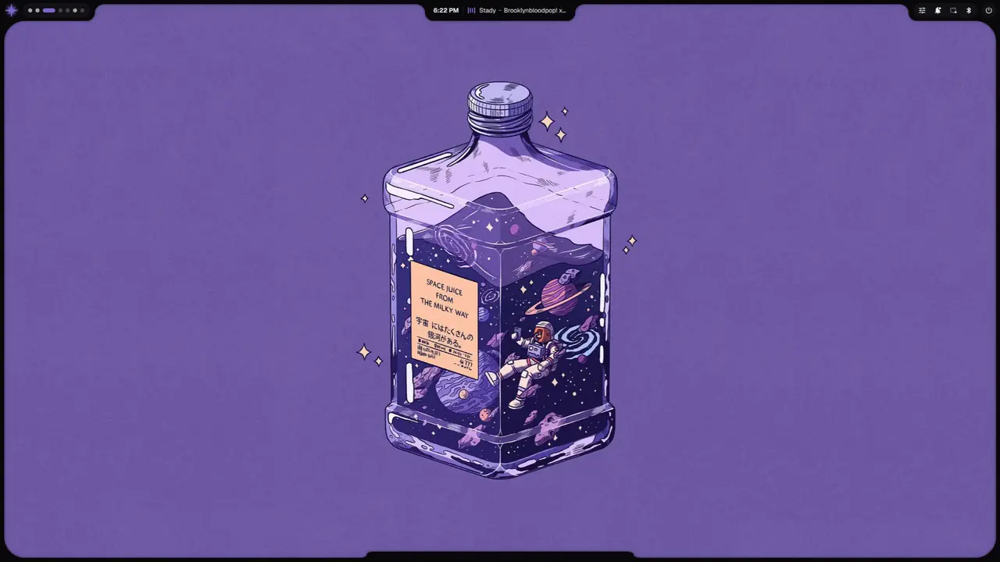
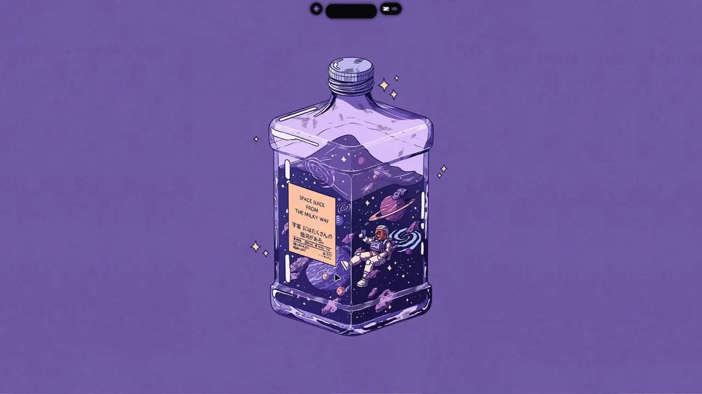
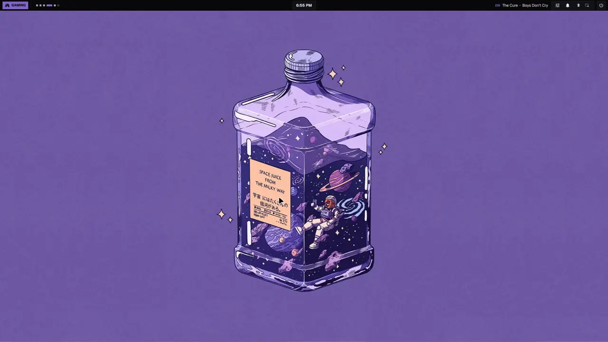
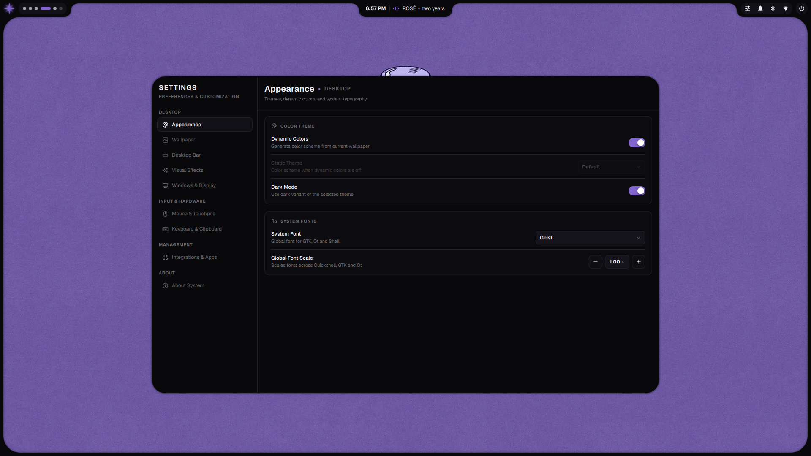
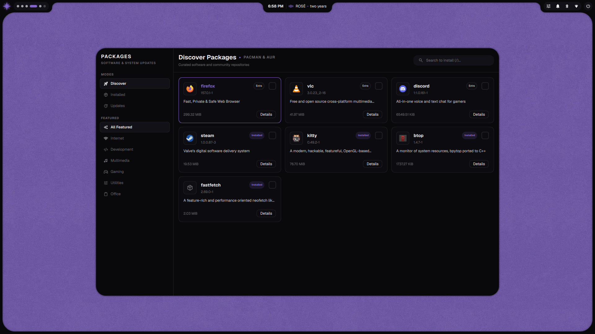
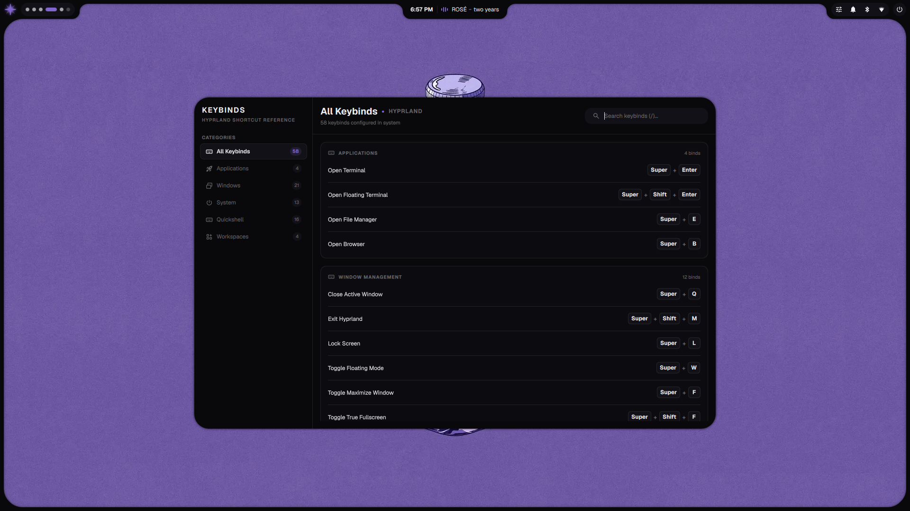

<div align="center">

# Minflair

**A modular, aesthetic Hyprland desktop environment for Arch Linux, powered by Quickshell and dynamic system-wide theming.**

<a href="#gallery">
  
</a>

<br />


</div>

## ✨ Features

- 🎨 **Unique Shell Styles** — Switch effortlessly between **Convex** (organic curved frames where widgets flow naturally into the screen contours) and **Island** (a floating pill bar with dynamic expandable widgets).
- 🎮 **One-Click Gaming Mode** — Maximize game performance instantly: strips away animations, blur, and borders while activating variable refresh rate (VRR) and ultra-low latency.
- 🌈 **Adaptive Wallpaper Theming** — Pick any wallpaper and watch your entire system adapt harmoniously—synchronizing your bar, terminals, Neovim, GTK, Qt, SDDM login screen, Obsidian, and apps in real time.
- 🎚️ **Unified On-Screen Display (OSD)** — Instant, hardware-synced visual indicators for volume, mic mute, brightness (internal panels and external monitors over DDC/CI), keyboard locks, touchpad toggles, and power alerts integrated directly into your active bar style.
- 🖼️ **Wallpaper Framing & Cropping** — Crop, align, and preview wallpapers directly from settings with live aspect-ratio framing, scaling options, and smooth auto-shuffle transitions.
- 🎛️ **Intuitive Settings Center** — Customize mouse sensitivity, touchpad gestures, system fonts, and bar appearance through an elegant graphical interface without editing config files.
- 🎵 **Music Player & Visualizer** — A standalone media widget with live audio visualizer bars, album art, interactive seek bar, and playback controls.
- 🔔 **Notification Center** — Stay organized with a dedicated notification panel, per-app grouped notification stacks, status bar unread badge, and one-click clear-all.
- 🍅 **Pomodoro Focus Timer** — Configurable focus, short-break, and long-break cycles with auto-start, notifications, sound cues, persistent state, and daily completed-session tracking.
- 📊 **System Usage Monitor** — Live CPU, GPU, RAM, and storage utilization cards with temperatures, clocks, VRAM usage, and per-disk breakdowns.
- 🗓️ **Unified Calendar** — A calendar popup integrated with the bar clock and available from both Convex and Island styles.
- 🔎 **Smart Launcher** — Fast application search enhanced with an inline calculator, web search prefixes (`g`, `yt`, `w`, `gh`, `ddg`), quick Minflair commands (`> settings`, `> pomodoro`, …), and a shell command runner.
- 🏝️ **Island Customization** — Toggle workspaces and system tray visibility, switch to a single-pill layout, and choose how many workspaces appear on the bar.
- 🖋️ **Obsidian Theme Sync** — Automatically generates and enables a CSS snippet in your Obsidian vaults so notes match the active wallpaper palette.
- 🚪 **Dynamic SDDM Login Screen** — A theme-synced login screen that follows your wallpaper and colors, complete with profile picture support.
- 📦 **Modern Package Manager** — Discover, inspect, install, and update official Arch Linux and AUR packages through a clean, searchable graphical store.
- 🖼️ **Wallpaper Selector** — Browse and switch your wallpaper collection on the fly from an interactive grid.
- 🔒 **Aesthetic Lock Screen** — A sleek lock screen that matches your active wallpaper and theme with quick system metrics.
- ⚡ **Developer-Ready Terminal** — Out-of-the-box developer environment featuring Zsh, Starship prompt, fast directory jumping, LazyGit, kitty split layouts with automatic axis, and a theme-synced Neovim setup.
- 🔋 **Battery Health Protection** — Built-in toggle to limit laptop battery charging to 80% to prolong battery lifespan.

---

## 🚀 Quick Install

```bash
# Clone this repository (shallow clone to save space and time)
git clone --depth 1 https://github.com/t4lentles5/minflair.git ~/.dotfiles

# Enter the directory
cd ~/.dotfiles

# Give execution permissions to the script and run it
chmod +x install.sh
./install.sh
```

> [!IMPORTANT]
>
> - This script is designed exclusively for **Arch Linux** distributions.
> - Run the script as your **normal user**. It will ask for `sudo` only when needed to install system packages.

---

## 🔄 Updating

Already using Minflair? Pull the latest changes and run the update script:

```bash
cd ~/.dotfiles
git pull
./update.sh
```

`update.sh` will:

- Back up the configuration it is about to replace to `~/.dotfiles_backup/<timestamp>/`.
- Copy the updated `config/` and `home/` files, keeping your Zsh history.
- Install any new official and AUR dependencies listed in `packages.txt` and `packages-aur.txt`.
- Refresh the `minflair-sddm` login theme without requiring `git` as root.
- Reapply the active theme and reload Hyprland and Quickshell.

> [!NOTE]
> The update overwrites configuration files with the repository versions. Your previous files are kept in the backup directory. To restore them:
>
> ```bash
> cp -a ~/.dotfiles_backup/<timestamp>/config/. ~/.config/
> cp -a ~/.dotfiles_backup/<timestamp>/home/. ~/
> ```
>
> You can preview the SDDM theme without logging out:
>
> ```bash
> sddm-greeter --test-mode --theme /usr/share/sddm/themes/minflair-sddm
> ```

---

## 🔧 Post-Installation Setup

### 1. Reboot

Once installation completes, **reboot your computer** so all services, themes, and shell environments take effect:

```bash
sudo reboot
```

### 2. Set your profile picture (`.face`)

To display your personal avatar on the dashboard, lock screen, and SDDM login screen, place a square image (`PNG` or `JPG`) at `~/.face`:

```bash
cp /path/to/your/avatar.png ~/.face
```

SDDM runs under its own system user (`sddm`). Because user home directories default to `700` (`drwx------`) permissions on Linux, grant SDDM traversal and read access via ACL so the avatar appears on the login screen:

```bash
setfacl -m u:sddm:x "$HOME"
setfacl -m u:sddm:r "$HOME/.face"
```

### 3. Add your wallpapers

Wallpapers are stored in `~/Pictures/Wallpapers/`. Add your favorite images there and use the wallpaper selector (`Ctrl + Alt + W`) to switch between them instantly.

### 4. Monitor Configuration

Displays are configured to auto-detect by default. If you need a custom resolution, refresh rate, or multi-monitor arrangement, configure:

```bash
~/.config/hypr/monitors.lua
```

### 5. Restore from Backup

If needed, the installer preserves a timestamped backup of your previous configuration at:

```
~/.dotfiles_backup/<timestamp>/
```

### 6. OCR Text Extraction Languages

The screen capture OCR feature comes with English and Spanish language packs preinstalled. To add other languages (such as French, German, or Japanese), install the corresponding package:

```bash
# Example for French
sudo pacman -S tesseract-data-fra
```

### 7. Battery Charge Limit (Laptops)

The Control Center includes an 80% charge limit toggle to prolong battery lifespan. The installer automatically detects your hardware and configures support for major laptop brands (ASUS, Lenovo, Dell, Acer, Apple Silicon, Framework, HP, and others).

### 8. Brightness on External Monitors (DDC/CI)

Internal laptop panels are controlled with `brightnessctl` out of the box. External monitors are controlled over DDC/CI with `ddcutil`, which the installer installs and configures: the `i2c-dev` module is loaded on boot and your user is added to the `i2c` group.

The group change only takes effect after logging out and back in (the installer already asks you to reboot). To check which backend is active at any time:

```bash
~/.config/quickshell/Scripts/system/brightness.sh backend
```

It prints `brightnessctl` for an internal panel, `ddcutil` for external monitors, or `none` when no supported display is found. On a laptop, the internal panel always takes priority over connected external monitors.

---

<a id="gallery"></a>

## 🖥️ Shell Styles & Desktop Experience

Minflair is designed around distinct bar architectures and a unified suite of desktop utilities. You can switch styles anytime directly from the Settings app:

### 🌟 Convex Style

The signature desktop layout. Features an organic curved bezel frame where top widgets (Control Center, Notifications, Music, Dashboard) and bottom tools (Launcher, Clipboard, Wallpaper Selector) connect directly into the screen contours.



### 🏝️ Island Style

A modern, floating pill bar with an expandable dynamic island center. Notifications, media playback, and quick controls expand smoothly from the island while preserving maximum screen real estate.



### 🎮 Gaming Mode

An ultra-clean, zero-overhead bar dedicated to gaming sessions. Strips away all blur, animations, and rounded frames, activating tear-free variable refresh rate (VRR) and minimal latency for maximum performance.



### 📱 Standalone Applications

Deep graphical customization built natively for Arch Linux:

<table align="center">
  <tr>
    <td align="center" width="50%">
      <b>Settings App</b><br />
      <br />
      Complete control over wallpapers, cropping, touchpad, and desktop effects.
    </td>
    <td align="center" width="50%">
      <b>Package Manager</b><br />
      <br />
      Searchable GUI store to inspect, install, and update Arch &amp; AUR packages.
    </td>
  </tr>
  <tr>
    <td align="center" width="50%">
      <b>Keybinds Cheat Sheet</b><br />
      <br />
      Interactive shortcut browser accessible anytime with <code>Super + K</code>.
    </td>
    <td align="center" width="50%">
      <b>Pomodoro</b><br />
      <br />
      Focus timer with configurable cycles, notifications, sound cues, and daily session tracking.
    </td>
  </tr>
</table>

### 🔒 Lock Screen

A clean, wallpaper-matched lock screen featuring PAM authentication, smooth unlock transitions, and real-time battery and system status.


### 🚪 SDDM Login Screen

A dynamic, theme-synced login screen (`minflair-sddm`) that adapts its background to your active wallpaper in real time, featuring smooth user authentication and profile picture support.


### 🎚️ On-Screen Display (OSD)

Centralized, minimal on-screen displays integrated natively into Quickshell IPC across both Convex and Island styles. Delivers instant visual feedback for volume, microphone mute, display brightness, Caps/Num Lock keys, touchpad toggles, power notifications, and screen capture actions.


### 🎛️ Shell Utilities & Overlays

All desktop styles share a cohesive, shared set of utilities:

- **Notification Center**: Dedicated panel for alert history with per-app grouping, expandable stacks, and an unread badge on the bar.
- **Native OSD & Hardware Status**: Hardware-responsive on-screen display for volume, microphone, brightness, caps/num lock, touchpad toggles, and power state.
- **Music & Visualizer**: Sleek media player with album artwork, live audio bars, and seek control.
- **Smart Launcher & Clipboard**: Keyboard-driven app search with calculator, web search prefixes, quick commands, and clipboard history management.
- **Calendar**: Unified calendar popup shared across Convex and Island styles.
- **System Usage**: CPU, GPU, memory, and storage monitoring with live metrics and per-disk details.
- **Pomodoro**: Focus timer with configurable cycles, auto-start, notifications, and sound cues.
- **Screen Capture**: All-in-one screenshot tool (region/window/delay/OCR) and screen recorder.
- **Power Menu**: Minimal session controls for sleep, reboot, and shutdown.

## ⌨️ Keybinds

> [!NOTE]  
> You don't need to memorize these! Press `SUPER + K` at any time to open the built-in **Keybinds Cheat Sheet** directly on your desktop!

Frequently used global toggles:

| Shortcut         | Action              |
| :--------------- | :------------------ |
| `CTRL + ALT + D` | Dashboard           |
| `CTRL + ALT + M` | Music player        |
| `CTRL + ALT + N` | Notification Center |
| `CTRL + ALT + F` | System Usage        |
| `CTRL + ALT + C` | Calendar            |
| `CTRL + ALT + T` | Pomodoro            |
| `CTRL + ALT + W` | Wallpaper Selector  |
| `SUPER + V`      | Clipboard history   |
| `SUPER + S`      | Minflair Settings   |

## ❓ Troubleshooting

<details>
<summary><b>Inspect Quickshell logs or debug UI issues</b></summary>

If any widget is not showing up or an error occurs in the UI, you can view live Quickshell logs in your terminal:

```bash
qs log
```

This will output real-time QML errors, warnings, missing components, or script failures.

</details>

<details>
<summary><b>Battery charge limit toggle not working</b></summary>

Ensure your laptop vendor supports charging thresholds via the Linux kernel. Check if your vendor's kernel module is loaded (e.g. `asus_wmi`, `ideapad_laptop`, `thinkpad_acpi`). For Acer laptops, the installer automatically configures `acer-wmi-battery-dkms`.

</details>

<details>
<summary><b>Brightness slider has no effect on an external monitor</b></summary>

Internal panels use `brightnessctl`, while external monitors use DDC/CI through `ddcutil`. The installer sets this up, but group membership requires a new session. If needed, run it manually and log out afterwards:

```bash
sudo pacman -S ddcutil
echo i2c-dev | sudo tee /etc/modules-load.d/i2c-dev.conf
sudo modprobe i2c-dev
sudo usermod -aG i2c "$USER"
```

Check the detected backend and whether the monitor exposes DDC/CI:

```bash
~/.config/quickshell/Scripts/system/brightness.sh backend
ddcutil detect
```

Some monitors ship with DDC/CI disabled in their OSD menu; enable it there. When nothing is detected, Minflair waits 30 seconds before retrying, so give it a moment after connecting a display.

</details>

<details>
<summary><b>Avatar (.face) not showing on SDDM or Quickshell dashboard</b></summary>

Place a square image at `~/.face` (PNG or JPG). The dashboard and SDDM read it from `$HOME/.face`.

If the avatar shows in test mode (`sddm-greeter --test-mode`) but not on the actual SDDM login screen, the `sddm` system user is blocked by restricted home directory permissions (`700`). Fix it by running:

```bash
setfacl -m u:sddm:x "$HOME"
setfacl -m u:sddm:r "$HOME/.face"
```

</details>

<details>
<summary><b>No wallpapers appear in the wallpaper selector</b></summary>

You must manually place your own wallpapers in the `~/Pictures/Wallpapers/` directory. Create this directory if it doesn't exist and add your images there.

</details>

<details>
<summary><b>GTK apps don't follow the theme change</b></summary>

Nautilus is automatically restarted when switching between light ↔ dark mode. For other GTK apps, you may need to close and reopen them. The `nwg-look` tool is used during installation to apply the initial GTK settings.

</details>

<details>
<summary><b>Notifications aren't showing</b></summary>

The installer disables `dunst` because Quickshell handles notifications natively. If you installed another notification daemon, it may conflict. Check with:

```bash
systemctl --user status dunst.service
```

</details>

<details>
<summary><b>Installation errors or packages failed to install</b></summary>

The installer automatically captures all warnings and errors in a log file. You can check it to find out exactly what went wrong:

```bash
cat ~/install_errors.log
```

If packages failed to install, ensure your mirrors are up to date (`sudo pacman -Syy`) and that your AUR helper is working correctly (`yay -Syu`).

</details>

## 📜 License and Credits

This project is licensed under the [GNU General Public License v3.0](LICENSE).

### Third-Party Assets & Projects

- **Tabler Icons**: Licensed under the [MIT License](https://github.com/tabler/tabler-icons/blob/master/LICENSE).
- **Material Symbols (Google Fonts)**: Licensed under the [Apache License 2.0](https://www.apache.org/licenses/LICENSE-2.0).
- **Material GNOME Theme**: Custom fork at [t4lentles5/material-gnome-theme](https://github.com/t4lentles5/material-gnome-theme) (upstream: [SakibShahariar/material-gnome-theme](https://github.com/SakibShahariar/material-gnome-theme)), licensed under the [GNU General Public License v3.0](https://github.com/SakibShahariar/material-gnome-theme/blob/main/LICENSE).
- **tokyo-night-sddm**: Custom fork at [t4lentles5/tokyo-night-sddm](https://github.com/t4lentles5/tokyo-night-sddm) (`minflair-sddm`) (upstream: [rototrash/tokyo-night-sddm](https://github.com/rototrash/tokyo-night-sddm)), licensed under the [GNU General Public License v3.0](https://github.com/rototrash/tokyo-night-sddm/blob/master/LICENSE). Tailored for Minflair with dynamic wallpaper background synchronization.
- **luna.nvim**: Custom fork at [t4lentles5/luna.nvim](https://github.com/t4lentles5/luna.nvim) (upstream: [WTFox/luna.nvim](https://github.com/WTFox/luna.nvim)), licensed under the [MIT License](https://github.com/WTFox/luna.nvim/blob/main/LICENSE). Tailored specifically for Minflair to enable real-time dynamic palette hot-reloading and automatic Lualine synchronization.
- **Simple Icons**: Licensed under the [CC0 1.0 Universal License](https://creativecommons.org/publicdomain/zero/1.0/).
